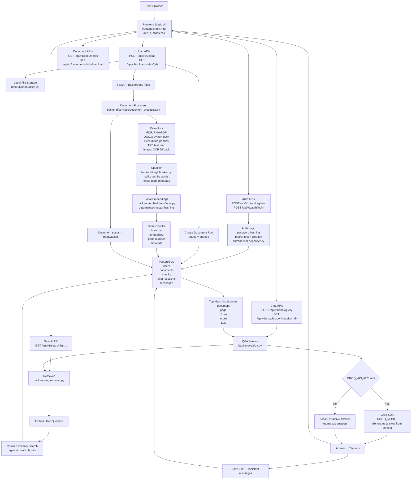
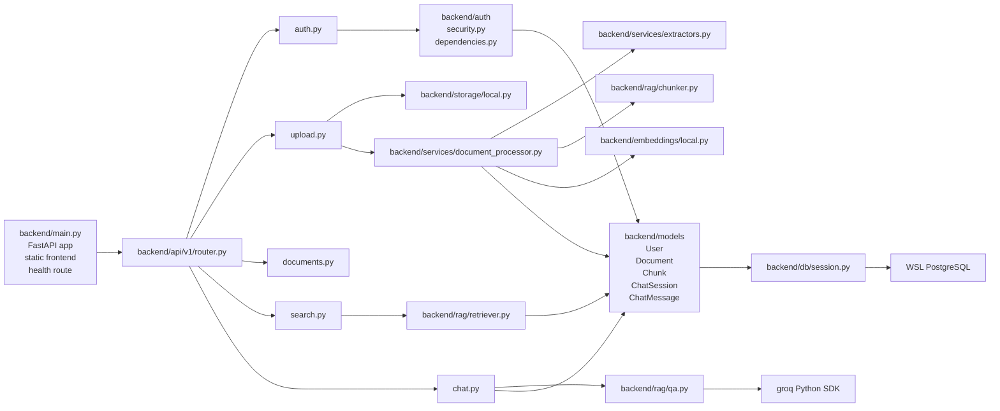

Here is the project architecture in one view:

**Module Map**

**Request Flow**

1. **Register/Login**
   `frontend/app.js` calls `/api/v1/auth/register` or `/api/v1/auth/login`.
   Backend stores user in PostgreSQL and returns a bearer token.

2. **Upload Document**
   Browser sends files to `/api/v1/upload`.
   Backend saves original files in `data/uploads/{user_id}` and creates `documents` rows with `queued` status.

3. **Process Document**
   Background task extracts text, chunks it, creates embeddings, and stores chunks in PostgreSQL.

4. **Ask Question**
   Browser calls `/api/v1/chat/query`.
   Backend embeds the question, retrieves matching chunks, sends context to Groq if `GROQ_API_KEY` exists, and returns answer with citations.

5. **Fallback Mode**
   If no Groq key is configured, the app still works by returning extractive answers from the most relevant chunks.