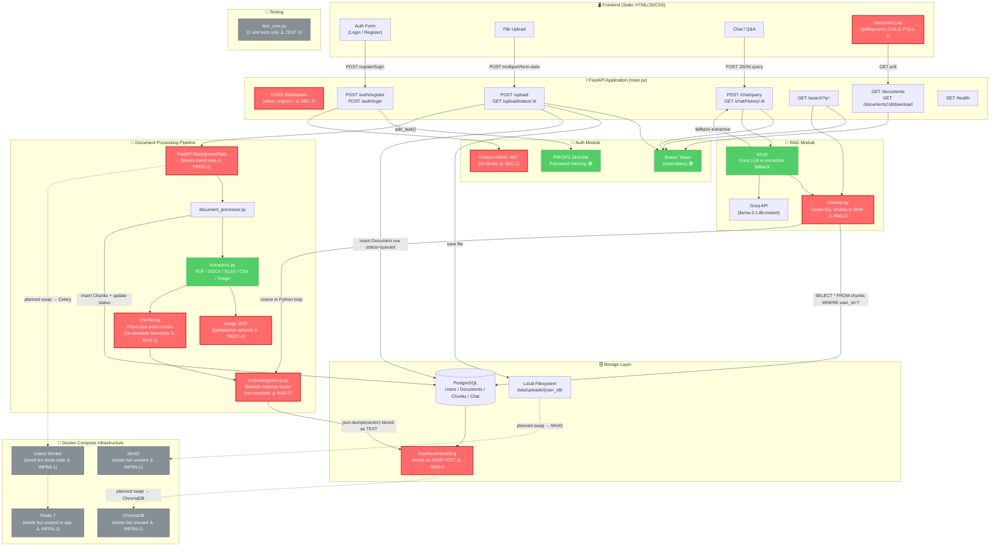
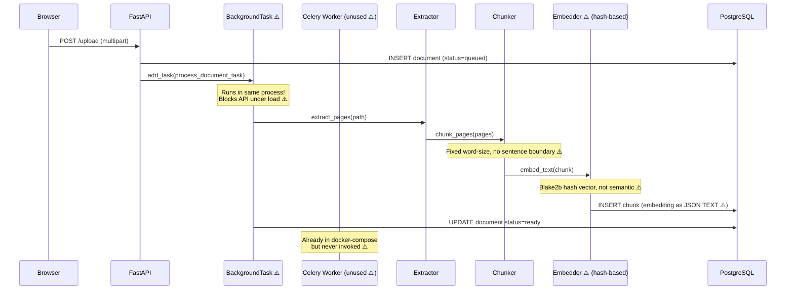
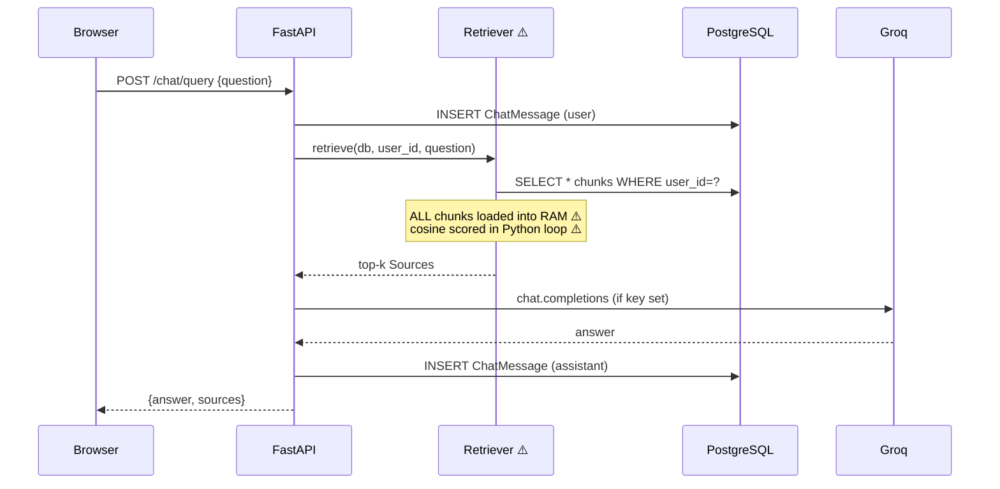
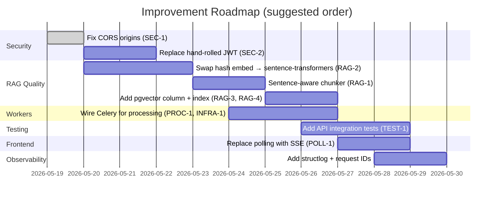

# AI Document Analyzer — Architecture Analysis & Improvement Map

## Current State Summary

The project is a **local-first RAG (Retrieval-Augmented Generation)** system built with FastAPI + PostgreSQL. It is a solid MVP but several flows have production gaps that need improvement before scaling.

---

## Architecture Diagram

> **Legend:**  
> 🟢 = Solid / Production-Ready  
> 🟡 = Acceptable for MVP, needs upgrade path  
> 🔴 = Needs immediate improvement (marked `⚠️`)

---

## ⚠️ Improvement Areas (Prioritized)

### 🔴 CRITICAL — Security

| ID | Location | Issue | Fix |
|---|---|---|---|
| **SEC-1** | `main.py:18` | `allow_origins=["*"]` — open CORS in production | Restrict to known frontend origins via env var |
| **SEC-2** | `auth/security.py` | Hand-rolled JWT with `hmac` — missing `nbf`, no key rotation, no refresh token | Replace with `python-jose` or `PyJWT`, add refresh token flow |

---

### 🔴 HIGH — RAG Quality

| ID | Location | Issue | Fix |
|---|---|---|---|
| **RAG-1** | `rag/chunker.py` | Fixed-size word chunks with no sentence/paragraph boundary awareness — splits mid-sentence | Use sentence-aware splitter (e.g. `langchain_text_splitters.RecursiveCharacterTextSplitter`) |
| **RAG-2** | `embeddings/local.py` | Blake2b hash-bucketing is a **bag-of-words hash** — semantically unaware; `"bank" (finance)` = `"bank" (river)` | Swap to `sentence-transformers` (`all-MiniLM-L6-v2`) for real semantic search |
| **RAG-3** | `rag/retriever.py:13` | `SELECT * FROM chunks WHERE user_id=?` loads **all user chunks into RAM** then scores in Python — O(n) per query | Add `pgvector` extension + `vector` column type, use ANN SQL (`<=>`) or swap to ChromaDB (already in docker-compose) |
| **RAG-4** | `models/document.py:32` | Embeddings stored as `TEXT` JSON (no vector index) — unusable for SQL-native similarity | Use `pgvector` or move to ChromaDB |

---

### 🟡 MEDIUM — Processing & Workers

| ID | Location | Issue | Fix |
|---|---|---|---|
| **PROC-1** | `api/v1/upload.py:47` | `BackgroundTasks` runs in the **same process/thread pool** as the API — heavy PDF processing blocks other requests | Route task to Celery worker (already wired in `docker-compose.yml`) |
| **PROC-2** | `services/extractors.py:65` | Image OCR silently fails and returns placeholder text — user has no feedback | Check for `pytesseract` at startup; return clear error status on document |
| **INFRA-1** | `docker-compose.yml` | Redis, ChromaDB, MinIO, Celery worker are all **declared but never used** by the application code | Wire Celery for document processing; wire ChromaDB for vector storage; wire MinIO for file storage |

---

### 🟡 MEDIUM — Frontend

| ID | Location | Issue | Fix |
|---|---|---|---|
| **POLL-1** | `frontend/app.js:91` | `setInterval(loadDocuments, 2500)` — polls forever even when all documents are ready, wastes bandwidth | Stop polling once all docs hit `ready`/`failed`; or use WebSocket / Server-Sent Events |

---

### 🟡 MEDIUM — Testing

| ID | Location | Issue | Fix |
|---|---|---|---|
| **TEST-1** | `tests/test_core.py` | Only **2 unit tests**, no API integration tests, no auth tests, no upload/processing tests | Add pytest fixtures with `TestClient`, test all endpoints, mock Groq, test error states |

---

### 🟢 LOW — Observability (Missing Entirely)

| Area | What's Missing |
|---|---|
| **Logging** | No structured logging (`logging` / `structlog`) — only exception messages in `document.error` |
| **Metrics** | No Prometheus / OpenTelemetry hooks |
| **Tracing** | No request tracing IDs — hard to correlate upload → background task → chunk → query |

---

## Data Flow: Upload → Processing (Current vs. Ideal)

---

## Data Flow: Query → Answer (Current vs. Ideal)

---

## Quick-Win Improvement Roadmap

